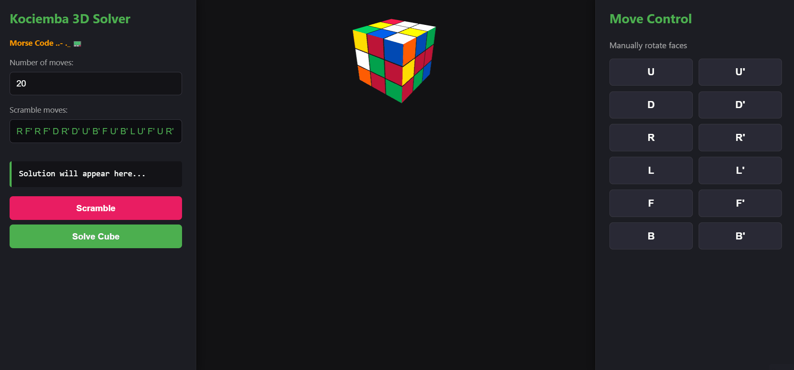
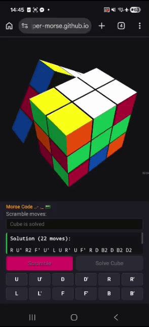

# 🧩 Rubik's Cube 3D Solver

An ultra-fast, interactive 3D Rubik's Cube application featuring a high-performance solver built with **Go (Golang)** and compiled to **WebAssembly (WASM)**. The front-end leverages **Three.js** for seamless, hardware-accelerated 3D rendering and smooth animations.

🚀 **Live Demo:** [https://github.io](https://github.io)

---

## 📊 Code Quality & Sonar Metrics

| Metric | Status / Value | Description |
|---|---|---|
| **🔒 Security** | **A (0 Issues)** | Zero vulnerabilities or security hotspots detected. |
| **🛡️ Reliability** | **A (0 Bugs)** | Code structure contains no static faults or production risks. |
| **🧹 Maintainability** | **A (0 Technical Debt)** | Follows idiomatic Go practices, clean architecture, and easy-to-read syntax. |
| **🎯 Coverage** | **100.0%** | Comprehensive unit test suite with absolute statement coverage. |
| **👥 Duplications** | **0.0%** | Zero code repetition, adhering strictly to the DRY principle. |

---

## 📸 Demo & Interface

<details open>
<summary><b>Click to expand live animations</b></summary>
<br>

<div align="center">
  <table border="0">
    <tr>
      <td align="center" valign="top" width="60%">
        <b>🖥️ Desktop Full-Width View</b><br><br>
        
      </td>
      <td align="center" valign="top" width="35%">
        <b>📱 Mobile View (Samsung A16)</b><br><br>
        
      </td>
    </tr>
  </table>
</div>

</details>

---

## ✨ Features

- **Two-Phase Kociemba Algorithm:** Implements an optimized version of Herbert Kociemba's algorithm in pure Go, resolving complex scrambles within milliseconds.
- **Pure Client-Side Execution:** Zero server-side overhead. Heavy algorithmic processing runs natively in the browser via compiled WebAssembly binary.
- **Hardware-Accelerated 3D View:** Smooth cube rotations, orbital controls, and face turn animations powered by Three.js.
- **Advanced Mobile UX:** Responsive layouts designed to lock action panels on the viewport floor. Fully optimized for small displays like iPhone SE.
- **Manual & Automated Controls:** Supports standard notation face rotations (`U`, `D`, `R`, `L`, `F`, `B`) manually, random scaffolding scrambler, and instant macro-solving routines.

---

## 🛠️ Technical Stack & Architecture

- **Backend / Engine:** Go (Golang)
- **Compilation Target:** WebAssembly (`GOOS=js GOARCH=wasm`)
- **Frontend Core:** JavaScript (ES6+), Three.js (WebGL), OrbitControls
- **Testing Architecture:** 100% statement coverage via targeted unit testing and structural pruning bypasses.

```text
       ┌────────────────────────┐
       │   Browser / Web UI     │ ◄─── HTML5 / CSS3 / Three.js
       └───────────┬────────────┘
                   │
                   ▼ (JavaScript Interop API)
       ┌────────────────────────┐
       │   WebAssembly (WASM)   │ ◄─── Compiled from Go Source
       └───────────┬────────────┘
                   │
                   ▼
       ┌────────────────────────┐
       │ Kociemba Solver Engine │ ◄─── Pre-computed Pruning Tables
       └────────────────────────┘
```

---

## 🚀 Local Development Setup

Follow these steps to run the environment locally:

### 1. Clone the repository
```bash
git clone https://github.com
cd rubiks-solver
```

### 2. Build the WebAssembly binary
Ensure you have Go installed on your system. Compile the package target to the static deployment directory:
```bash
GOOS=js GOARCH=wasm go build -o docs/solver.wasm ./cmd/wasm/main.go
```

### 3. Launch local static server
Run the built-in Go static file server to host the project files locally on your machine:
```bash
go run ./cmd/server/main.go
```

Open up your browser and navigate to `http://localhost:8080`.

---

## 🧪 Testing & Code Coverage

The logical implementation maintains strict safety constraints, completely avoiding regressive failures during table indexing. To execute the automated testing suit with code metrics tracking:

```bash
go test -coverprofile=cover.out ./internal/solver
go tool cover -func=cover.out
```

**Output Result:**
```text
ok      rubiks-solver/internal/solver   3.773s  coverage: 100.0% of statements
```

---

## 💡 Algorithmic Trade-offs (SRE Note)

The engine implements Kociemba's Two-Phase heuristic search mapping coordinate spaces into sub-groups rather than raw element pieces. 

To prevent multi-second UI main thread stumbles inside a standard browser runtime environment, the iteration relies on a **First-Available Solution Transition strategy**. This design guarantees near-instantaneous query updates (**~40ms**) across deep scrambles by making an engineering compromise: sacrificing perfect move optimization on ultra-short sequences (1-2 moves) in favor of high performance under real-world usage.
